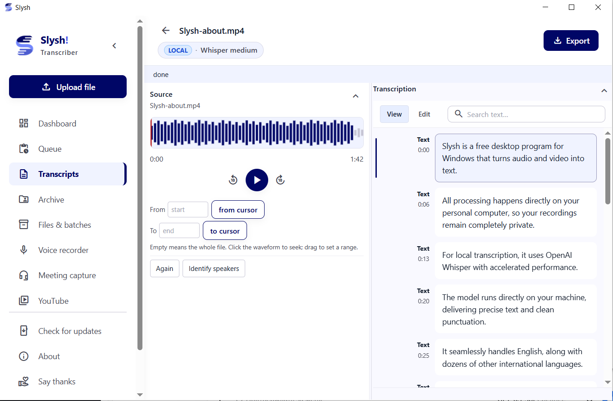
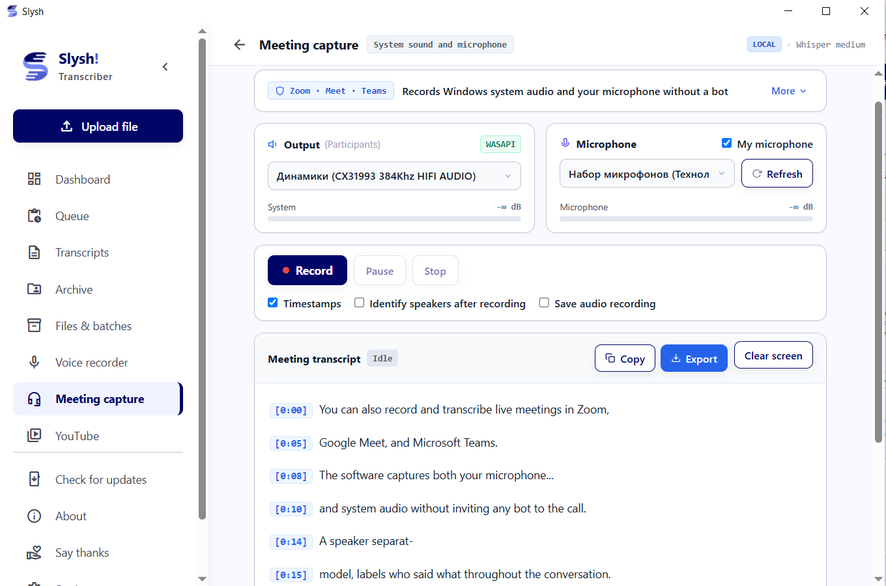
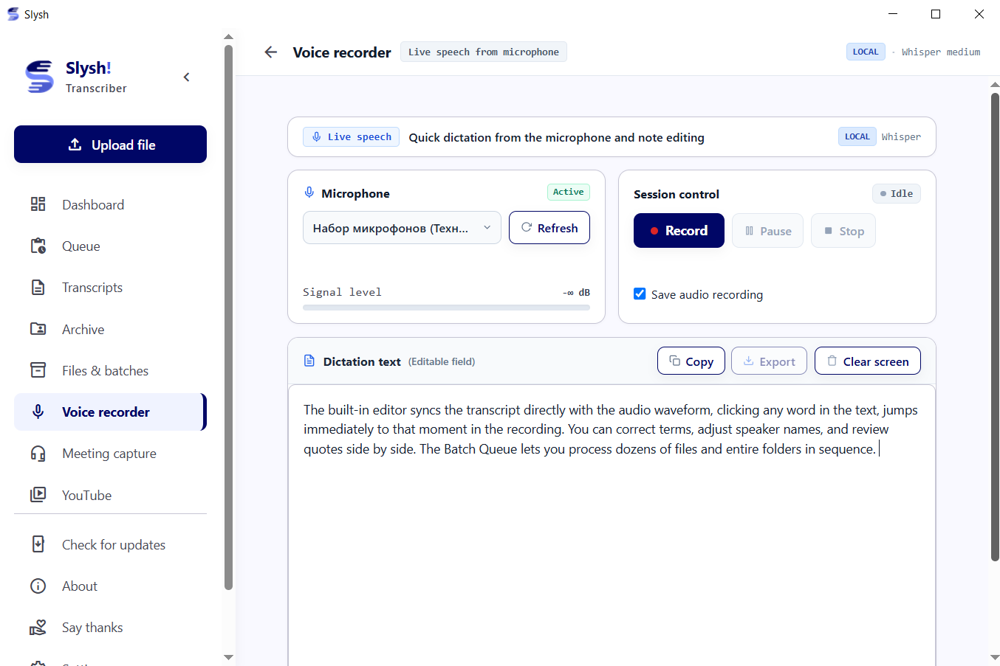
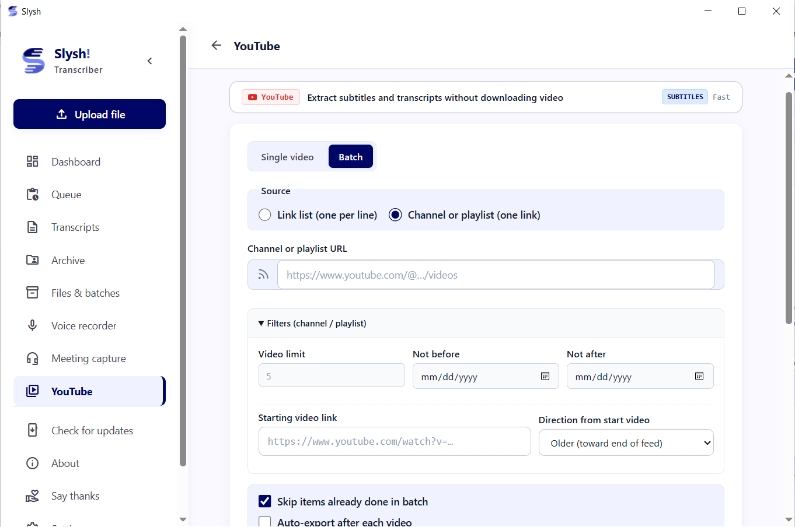
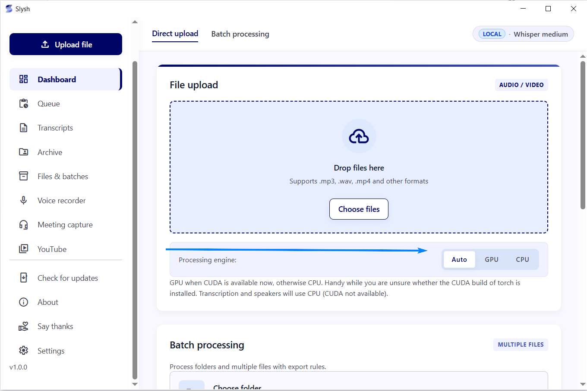
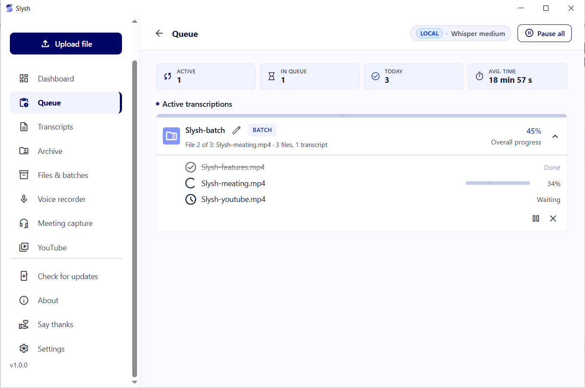

<p align="center">
  <b>English</b> • <a href="README.ru.md"><b>🇷🇺 Перейти к русской версии</b></a>
</p>

<p align="center">
  <picture>
    <source media="(prefers-color-scheme: dark)" srcset="docs/assets/brand/horizontal-lockup.png">
    
  </picture>
</p>

<p align="center">
  <strong>Free desktop speech-to-text workstation for Windows with SOTA Russian (GigaAM) & multilingual Whisper</strong><br>
  <em>From sound. Into meaning.</em>
</p>

<p align="center">
  <a href="https://github.com/dabder88/slysh/releases/latest"></a>
  <a href="https://slyshai.pro/en/"></a>
  
  <a href="LICENSE"></a>
  
  
  <a href="https://t.me/dabder88"></a>
  <a href="https://pay.cloudtips.ru/p/4e14b5b2"></a>
</p>

<p align="center">
  <a href="https://github.com/dabder88/slysh/releases/latest/download/Slysh-Setup-en.exe">
    
  </a>
  <a href="https://slyshai.pro/en/">
    
  </a>
  <a href="README.ru.md">
    
  </a>
</p>

<details>
  <summary><b>📖 Table of Contents</b> <i>(click to expand)</i></summary>

  - [💡 What is Slysh!?](#-what-is-slysh)
  - [⚡ Comparison Matrix](#-comparison-matrix)
  - [🖥️ Key Workflows & Visual Tour](#️-key-workflows--visual-tour)
  - [🚀 Getting Started](#-getting-started)
  - [🏗️ Architecture](#️-architecture)
  - [📄 License & Terms](#-license--terms)
  - [💖 Support the Author](#-support-the-author)
  - [📈 Star History](#-star-history)
</details>

---

## 💡 What is Slysh!?

**Slysh!** is a dedicated Windows desktop workstation designed for accurate, private speech-to-text transcription. Created for podcasters, journalists, editors, researchers, product managers, and developers who need a reliable, permanent audio archive without per-minute SaaS charges.

- 🏆 **SOTA Russian Accuracy**: Powered by Sber AI's **GigaAM v3** Conformer RNNT — outperforms Whisper Large v3 on Russian terminology and rapid dialogue without phantom hallucinations.
- 🌍 **Multilingual Precision**: Built-in **OpenAI Whisper** and **Faster-Whisper** for robust multilingual transcription across 90+ languages.
- 🎙️ **Bot-Free Meeting Capture**: Silently captures Zoom, Microsoft Teams, Google Meet, and Telegram calls via Windows WASAPI loopback mixed with your microphone. No bot accounts joining the meeting, no cloud telemetry.
- 👥 **Speaker Diarization**: High-fidelity speaker separation powered by NVIDIA NeMo Sortformer. Identifies who said what without sending biometric voiceprints online.
- 📺 **YouTube Channels & Playlists**: Batch-extract clean author or auto-generated subtitles with custom date filters and duplicate skipping. Zero video download needed.
- ⚡ **Hybrid Architecture**: Run 100% offline on your NVIDIA GPU / CPU, or connect free cloud quotas (Groq 8h/day free tier, Gladia solaria-1 starter credits, Deepgram, OpenRouter) with zero local GPU load.
- 🗄️ **Local SQLite Library**: Synced audio player, interactive waveform, full-text search, and multi-file background queues.

---

## ⚡ Comparison Matrix

| Feature / Metric | 🎙️ **Slysh!** | ⚡ **Vibe** | 🤖 **OpenAI Whisper Desktop** | ☁️ **Otter.ai / Fireflies** |
|:---|:---:|:---:|:---:|:---:|
| **Russian Speech Accuracy** | **🏆 SOTA (GigaAM v3)** | Moderate (Whisper) | Moderate (Whisper) | Poor / Broken |
| **Meeting Audio Capture** | **✅ Native WASAPI Loopback + Mic** | ⚠️ System audio only | ❌ Audio files only | ⚠️ Intrusive Bot Joins Call |
| **Bot-Free Privacy** | **✅ 100% Invisible to Call** | ✅ Local | ✅ Local | ❌ Audio Recorded on 3rd-Party Server |
| **Speaker Diarization** | **✅ Local (NeMo Sortformer)** | ❌ No | ❌ No | ✅ Cloud Only |
| **YouTube Channel Batching** | **✅ Native Subtitles & Playlists** | ❌ Audio download only | ❌ Manual script | ❌ No |
| **100% Offline Air-Gapped Mode**| **✅ Full Local Isolation** | ✅ 100% Local | ✅ Local | ❌ Cloud Only ($15–$30/mo) |
| **Zero-GPU Cloud Fallback** | **✅ Groq / Gladia / Deepgram** | ❌ No Cloud Engine | ❌ No | ✅ Cloud Only |
| **Library & SQLite Archive** | **✅ Queue, Editor & Storage** | ⚠️ Single file export | ❌ None | ✅ Web dashboard |
| **Pricing** | **Free for Personal Use** | Free | Free | Paid Subscription |

> 🔬 **Reproducibility Note**: Benchmarks evaluated on Windows 11 with NVIDIA CUDA. Russian ASR tested on Golos test set: GigaAM RNNT achieves 8–12% WER vs 22–26% for Whisper-large-v3 on conversational Russian.

---

## 🖥️ Key Workflows & Visual Tour

### 1. Synchronized Audio Player & Waveform Editor
Click any phrase in the transcript to jump audio playback directly to that moment. Fix typos and edit technical terms on the fly while preserving millisecond timestamp accuracy.

<p align="center">
  
</p>

---

### 2. Bot-Free Meeting Recording (WASAPI Loopback + Mic)
Silently record Zoom, Google Meet, Microsoft Teams, Slack, or Telegram calls. Captures speaker audio directly from Windows sound output mixed with your microphone, without inviting awkward bots or requiring host permissions.

<p align="center">
  
</p>

---

### 3. PC Voice Typing & Dictaphone
Instantly capture ideas, drafts, or meeting notes with high-accuracy microphone dictation. Text is punctuated automatically and saved straight into your permanent library.

<p align="center">
  
</p>

---

### 4. YouTube Channels & Playlists to Subtitles
Paste a channel or playlist link to batch-collect clean author or automatic captions. Includes date filters, duplicate skipping, and auto-export to Markdown without downloading gigabytes of video.

<p align="center">
  
</p>

---

### 5. Engine Management & Processing Pipeline

| AI Engine & Cloud API Management | Multi-File Task Queue & SQLite Archive |
|:---:|:---:|
|  |  |
| *Switch between CUDA GPU, CPU & Free Cloud APIs* | *Background worker queue & local SQLite database* |

---

## 🚀 Getting Started

### Option A: Official Windows Installer (Recommended)
1. Download **`Slysh-Setup-en.exe`** from [GitHub Releases](https://github.com/dabder88/slysh/releases/latest) (button above) or [slyshai.pro](https://slyshai.pro/en/).
2. Run the installer and launch Slysh! from your desktop or Start Menu.
3. Choose your preferred mode: use free cloud keys (Groq/Gladia) instantly, or click **Download Models** in Settings to run 100% offline.

---

### Option B: Run from Source (Developers)

#### Prerequisites
- Windows 10 or Windows 11 (64-bit)
- [uv](https://docs.astral.sh/uv/getting-started/installation/) package manager installed
- [ffmpeg](https://ffmpeg.org/download.html) in your system `PATH`
- Python 3.12

```powershell
# 1. Clone repository
git clone https://github.com/dabder88/slysh.git
cd slysh

# 2. Launch
.\Slysh.bat
```
*On the first run, `uv` automatically sets up the lightweight UI environment in seconds. You can choose to download offline model weights or connect cloud APIs via the in-app prompt.*

---

## 🏗️ Architecture

Slysh! employs strict process isolation so heavy AI inference never freezes the desktop window:

```
Slysh.bat / Slysh.exe
    │
    ├── UI Process (FastAPI + uvicorn + pywebview)
    │     ├── Serves local web UI & SQLite app.db
    │     ├── Direct WASAPI audio loopback & mic capture
    │     └── Zero PyTorch in memory (instant window startup)
    │
    └── Dedicated Engine Subprocess (Isolated on-demand)
          ├── PyTorch (CUDA / CPU)
          ├── GigaAM (RNNT / CTC) & Faster-Whisper
          └── NeMo Speaker Diarization
```

See [CONTRIBUTING.md](CONTRIBUTING.md) for architecture constraints and [COPYRIGHT-HOLDER.md](COPYRIGHT-HOLDER.md) for licensing.

---

## 📄 License & Terms

Slysh! is proprietary software made available free of charge for personal, private, non-commercial use.
- Source code viewing and private personal builds are permitted under the [LICENSE](LICENSE).
- Official pre-built installers are governed by the EULA included in the setup wizard.
- Third-party open-source libraries and models are subject to their respective licenses (see [THIRD_PARTY_NOTICES.md](THIRD_PARTY_NOTICES.md)).

---

## 💖 Support the Author

Slysh! is developed independently without venture capital, ads, or paid subscriptions. If Slysh! helps you in your daily work:
- ⭐ **Star this repository** on GitHub!
- ☕ **Support the author** via [CloudTips](https://pay.cloudtips.ru/p/4e14b5b2).
- 💬 **Feedback & Inquiries**: Telegram [@dabder88](https://t.me/dabder88) | Email: [dabder@mail.ru](mailto:dabder@mail.ru)

---

## 📈 Star History

<p align="center">
  <a href="https://star-history.com/#dabder88/slysh&Date">
    <picture>
      <source media="(prefers-color-scheme: dark)" srcset="https://api.star-history.com/svg?repos=dabder88/slysh&type=Date&theme=dark" />
      <source media="(prefers-color-scheme: light)" srcset="https://api.star-history.com/svg?repos=dabder88/slysh&type=Date" />
      
    </picture>
  </a>
</p>

<p align="center">
  <i>If Slysh saved you hours transcribing meetings, lectures, or audio files — please consider giving it a ⭐ star! It helps the project grow and supports private offline AI.</i>
</p>
