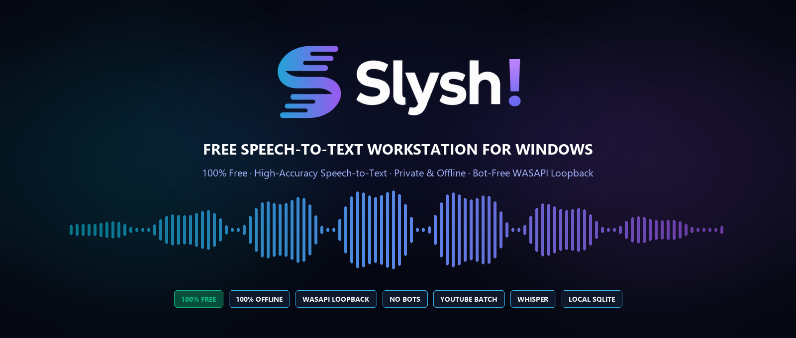

<p align="center">
  
</p>

# Slysh!

[](https://github.com/dabder88/slysh/releases/latest)
[](https://slyshai.pro/en/)
[](https://github.com/dabder88/slysh)
[](LICENSE)
[](https://github.com/dabder88/slysh)
[](https://docs.astral.sh/uv/)

**English** · [🇷🇺 Перейти к русской версии](README.ru.md)

Dedicated Windows desktop workstation for private, high-accuracy speech-to-text transcription. Built for podcasters, journalists, editors, researchers, product managers, and developers who need a permanent local audio archive without recurring per-minute cloud fees.

Powered by Sber AI's SOTA **GigaAM v3** Conformer RNNT for Russian speech and **OpenAI Whisper** for 90+ languages. Operates 100% offline without sending biometric voice data online, captures conference calls silently via Windows WASAPI loopback without bot accounts, and extracts entire YouTube channels into clean subtitles without downloading video files.

[Download for Windows (.exe)](https://github.com/dabder88/slysh/releases/latest) · [Official Website](https://slyshai.pro/en/)

---

## Contents

- [Interface](#interface)
- [Key Capabilities](#key-capabilities)
- [Core Features](#core-features)
- [Comparison](#comparison)
- [Installation](#installation)
- [Architecture](#architecture)
- [License](#license)
- [Support](#support)
- [Star History](#star-history)

---

## Interface

| Synchronized Waveform Editor | Bot-Free Meeting Recording |
|:---:|:---:|
|  |  |
| *Click any word in the transcript to jump audio playback* | *Silently captures system sound + microphone without bots* |

| Voice Typing & Dictaphone | YouTube Channel & Playlist Batching |
|:---:|:---:|
|  |  |
| *Continuous microphone dictation with auto-punctuation* | *Direct subtitle extraction without video download* |

| Engine & Cloud API Management | Multi-File Task Queue & SQLite Library |
|:---:|:---:|
|  |  |
| *Switch between CUDA GPU, CPU & free cloud quotas* | *Permanent background worker queue & SQLite storage* |

---

## Key Capabilities

**Speech Recognition**
- SOTA Russian speech recognition powered by GigaAM v3 Conformer RNNT (outperforms Whisper Large on rapid conversational speech and technical terms).
- Multilingual transcription across 90+ languages via OpenAI Whisper and Faster-Whisper.
- Automatic capitalization and sentence boundary punctuation.

**Meeting Recording & Audio Capture**
- Bot-free call recording via Windows WASAPI loopback mixed with microphone input.
- Fully invisible to Zoom, Microsoft Teams, Google Meet, Slack, and Telegram calls.
- Offline speaker separation (diarization) via NVIDIA NeMo Sortformer.

**YouTube & Subtitles**
- Batch collection of author and automatic captions from channels and playlists.
- Custom date filtering and automatic duplicate skipping.
- Instant export to SRT, VTT, TXT, and clean Markdown.

**Workflow & Storage**
- Interactive audio player: clicking any transcript phrase jumps playback directly to that millisecond.
- Integrated SQLite database with full-text search across all recorded transcripts.
- Multi-file task queue with background processing and stage-by-stage progress tracking.

**Compute Options**
- 100% offline air-gapped execution on local NVIDIA GPU (CUDA) or CPU.
- Optional free cloud quota integration (Groq free tier, Gladia, Deepgram, OpenRouter) for zero-GPU hardware.

---

## Core Features

### Bot-Free Meeting Capture (WASAPI Loopback)
Conventional meeting transcription tools force an intrusive bot to join the call, alerting attendees and routing audio through third-party servers. Slysh! taps directly into the Windows audio stack (WASAPI loopback) and captures the speaker output combined with your microphone. The recording remains 100% invisible to the meeting host and software.

### SOTA Russian Accuracy (GigaAM v3)
While OpenAI Whisper excels across global languages, it often hallucinates or degrades on conversational Russian slang and dense technical jargon. Sber AI's GigaAM v3 RNNT model was trained on thousands of hours of native Russian speech, delivering significantly lower Word Error Rate (WER) and natural punctuation without repetitive loops.

### Batch YouTube Channel Ingestion
Instead of downloading gigabytes of video to extract audio, Slysh! fetches native author or auto-generated YouTube caption tracks in seconds. Paste any channel URL or playlist, set date boundaries, and export organized Markdown dossiers for LLM analysis, study notes, or archiving.

### Process Isolation & Desktop Speed
Desktop AI applications frequently freeze during heavy model inference. Slysh! decouples the frontend UI (FastAPI + pywebview) into an ultra-fast, lightweight process that consumes minimal RAM. PyTorch and model weights are initialized exclusively inside an isolated engine worker subprocess, ensuring instant window launch and smooth UI interaction.

---

## Comparison

| Feature / Metric | Slysh! | Vibe | OpenAI Whisper Desktop | Otter.ai / Fireflies |
|:---|:---:|:---:|:---:|:---:|
| **Russian Speech Accuracy** | **SOTA (GigaAM v3)** | Moderate (Whisper) | Moderate (Whisper) | Poor / Broken |
| **Meeting Audio Capture** | **WASAPI Loopback + Mic** | System audio only | Audio files only | Intrusive Bot Joins Call |
| **Bot-Free Privacy** | **100% Invisible to Call** | Local | Local | Audio Sent to 3rd-Party Server |
| **Speaker Diarization** | **Local (NeMo Sortformer)** | No | No | Cloud Only |
| **YouTube Channel Batching** | **Native Subtitles & Playlists** | Audio download only | Manual script | No |
| **100% Offline Air-Gapped Mode**| **Full Local Isolation** | 100% Local | Local | Cloud Only ($15–$30/mo) |
| **Zero-GPU Cloud Fallback** | **Groq / Gladia / Deepgram** | No Cloud Engine | No | Cloud Only |
| **Library & SQLite Archive** | **Queue, Editor & Storage** | Single file export | None | Web dashboard |
| **Pricing** | **Free for Personal Use** | Free | Free | Paid Subscription |

> **Reproducibility Note**: Evaluated on Windows 11 with NVIDIA CUDA. Russian ASR tested on Golos test set: GigaAM RNNT achieves 8–12% WER vs 22–26% for Whisper-large-v3 on conversational Russian.

---

## Installation

### Option A: Official Windows Installer (Recommended)

1. Download the latest installer from [GitHub Releases](https://github.com/dabder88/slysh/releases/latest):
   - **[Slysh-Setup-1.0.4-en.exe](https://github.com/dabder88/slysh/releases/download/v1.0.4/Slysh-Setup-1.0.4-en.exe)** (English setup wizard)
   - **[Slysh-Setup-1.0.4-ru.exe](https://github.com/dabder88/slysh/releases/download/v1.0.4/Slysh-Setup-1.0.4-ru.exe)** (Русский мастер установки)
2. Run the installer and launch Slysh! from your desktop or Start Menu.
3. In Settings, choose whether to download offline GigaAM/Whisper models or connect free cloud API keys (Groq, Gladia).

---

### Option B: Run from Source (Developers)

#### Prerequisites
- Windows 10 or Windows 11 (64-bit)
- [uv](https://docs.astral.sh/uv/getting-started/installation/) package manager
- [ffmpeg](https://ffmpeg.org/download.html) in your system `PATH`
- Python 3.12

```powershell
# 1. Clone repository
git clone https://github.com/dabder88/slysh.git
cd slysh

# 2. Launch
.\Slysh.bat
```

*On the first run, `uv` configures the lightweight UI environment automatically in seconds.*

---

## Architecture

Slysh! employs strict process isolation so heavy AI inference never freezes the desktop window:

```text
Slysh.bat / Slysh.exe
    │
    ├── UI Process (FastAPI + uvicorn + pywebview)
    │     ├── Serves local web UI & SQLite app.db
    │     ├── Direct WASAPI audio loopback & mic capture
    │     └── Zero PyTorch in memory (instant window startup)
    │
    └── Dedicated Engine Subprocess (Isolated on-demand)
          ├── PyTorch (CUDA / CPU)
          ├── GigaAM (RNNT / CTC) & Faster-Whisper
          └── NeMo Speaker Diarization
```

See [CONTRIBUTING.md](CONTRIBUTING.md) for architectural constraints and [COPYRIGHT-HOLDER.md](COPYRIGHT-HOLDER.md) for licensing.

---

## License

Slysh! is proprietary software made available free of charge for personal, private, non-commercial use.
- Source code viewing and personal builds are permitted under the [LICENSE](LICENSE).
- Official pre-built installers are governed by the EULA included in the setup wizard.
- Third-party open-source libraries and models are subject to their respective licenses (see [THIRD_PARTY_NOTICES.md](THIRD_PARTY_NOTICES.md)).

---

## Support

Slysh! is developed independently without venture capital, ads, or paid subscriptions. If Slysh! helps you in your daily work:
- Star this repository on GitHub.
- Support the author via [CloudTips](https://pay.cloudtips.ru/p/4e14b5b2).
- Contact: Telegram [@dabder88](https://t.me/dabder88) | Email: [dabder@mail.ru](mailto:dabder@mail.ru)

---

## Star History

<p align="center">
  <a href="https://star-history.com/#dabder88/slysh&Date">
    <picture>
      <source media="(prefers-color-scheme: dark)" srcset="https://api.star-history.com/svg?repos=dabder88/slysh&type=Date&theme=dark" />
      <source media="(prefers-color-scheme: light)" srcset="https://api.star-history.com/svg?repos=dabder88/slysh&type=Date" />
      
    </picture>
  </a>
</p>
