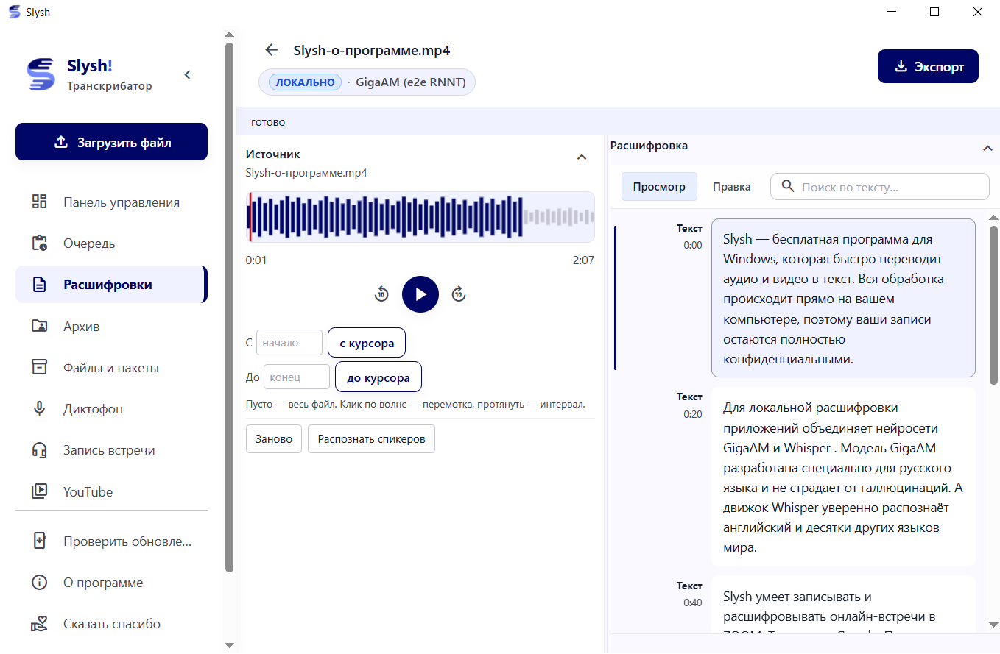
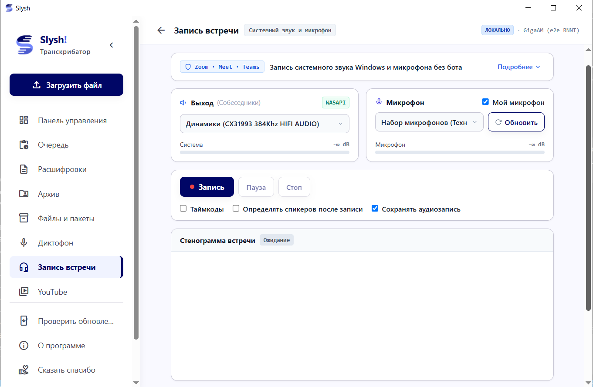
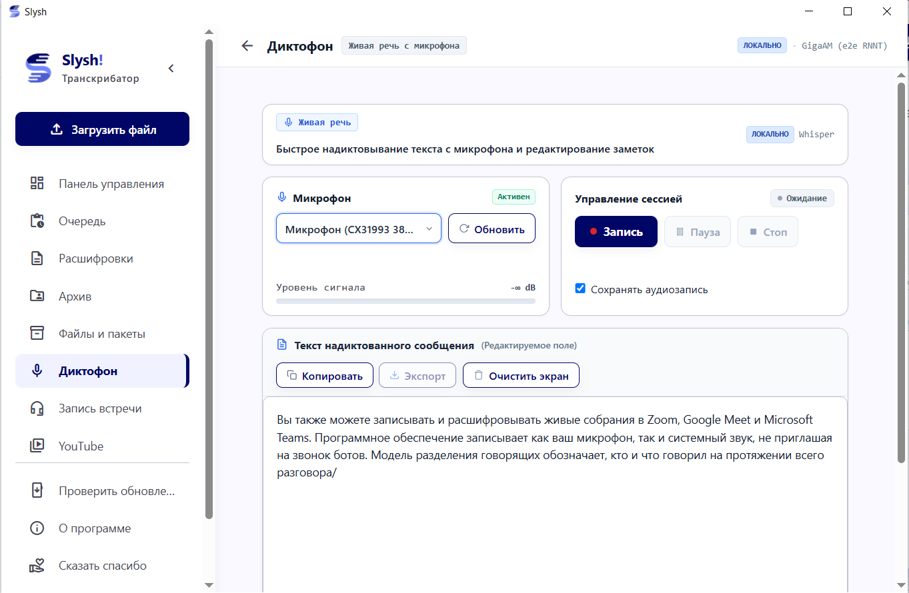
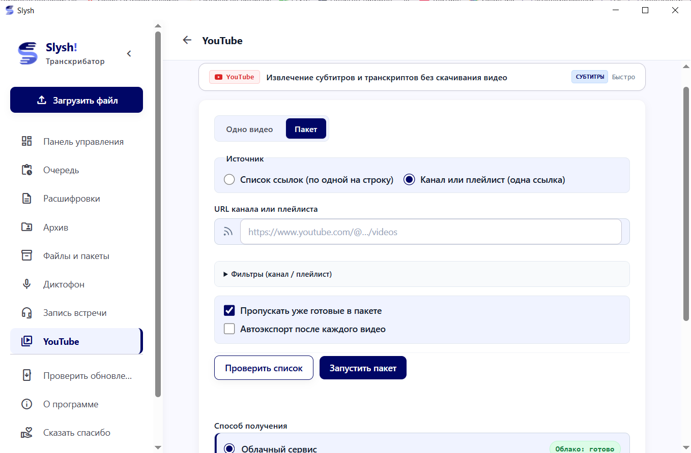
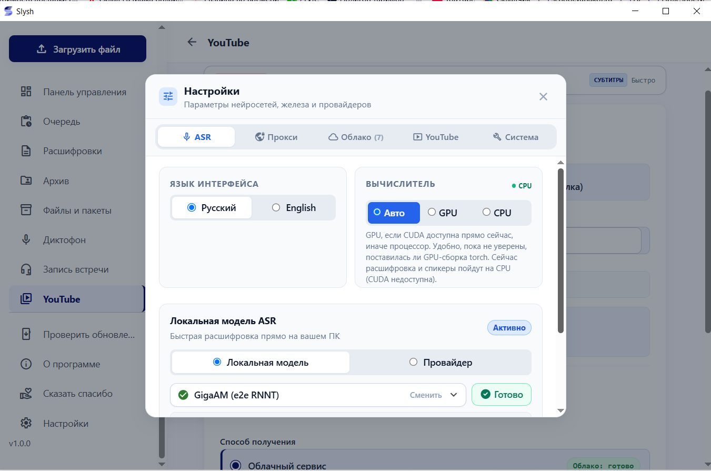
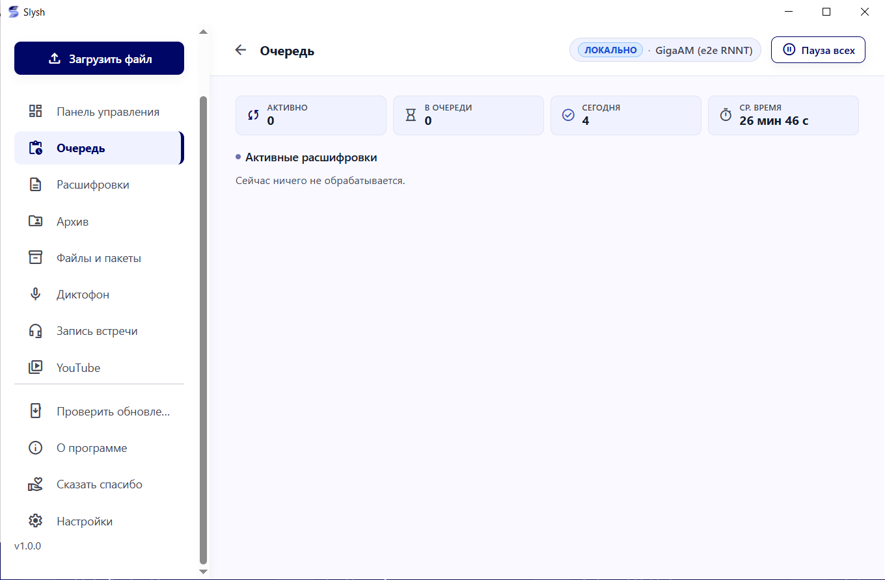

<p align="center">
  
</p>

# Slysh!

[](https://github.com/dabder88/slysh/releases/latest)
[](https://slyshai.pro/)
[](https://github.com/dabder88/slysh)
[](LICENSE)
[](https://github.com/dabder88/slysh)
[](https://docs.astral.sh/uv/)
[](https://t.me/dabder88)
[](https://pay.cloudtips.ru/p/4e14b5b2)

[English](README.md) · **Русский**

Десктопная программа для Windows для точной и приватной расшифровки речи в текст. Создана для журналистов, редакторов, подкастеров, исследователей, аналитиков и разработчиков, которым нужен постоянный локальный архив расшифровок без поминутной оплаты облачных SaaS.

Оснащена моделью **GigaAM v3** Conformer RNNT от SaluteDevices (SOTA по точности распознавания русского языка) и мультиязычной моделью **OpenAI Whisper** для 90+ языков. Работает полностью локально без передачи голоса на внешние серверы, тихо записывает созвоны через системный звук Windows (WASAPI loopback) без ботов-шпионов и пакетно выгружает субтитры целых YouTube-каналов без скачивания видео.

[Скачать для Windows (.exe)](https://github.com/dabder88/slysh/releases/latest) · [Официальный сайт](https://slyshai.pro/)

---

## Содержание

- [Как это выглядит](#как-это-выглядит)
- [Что умеет](#что-умеет)
- [Возможности](#возможности)
- [Сравнение](#сравнение)
- [Установка](#установка)
- [Архитектура](#архитектура)
- [Лицензия](#лицензия)
- [Поддержка](#поддержка)
- [История звезд](#история-звезд)

---

## Как это выглядит

| Синхронный редактор и аудиоплеер | Запись встреч и созвонов (WASAPI) |
|:---:|:---:|
|  |  |
| *Клик по любому слову в тексте перематывает аудиоплеер* | *Тихий захват системного звука + микрофон без ботов* |

| Голосовой ввод и диктофон | Пакетная работа с YouTube |
|:---:|:---:|
|  |  |
| *Надиктовка заметок с микрофона с автопунктуацией* | *Выгрузка субтитров с каналов без скачивания видео* |

| Управление AI-движками и облаком | Очередь задач и локальная база SQLite |
|:---:|:---:|
|  |  |
| *Переключение между CUDA GPU, CPU и бесплатным облаком* | *Фоновая очередь задач и постоянное хранилище* |

---

## Что умеет

**Распознавание речи**
- SOTA-точность на русском языке на базе GigaAM v3 Conformer RNNT (превосходит Whisper Large на разговорной речи и терминологии без галлюцинаций).
- Мультиязычная транскрибация более чем 90 языков через OpenAI Whisper и Faster-Whisper.
- Автоматическая расстановка заглавных букв и знаков препинания.

**Запись созвонов и аудио**
- Запись встреч без подключения сторонних ботов через системный аудиопоток Windows (WASAPI loopback) в миксе с микрофоном.
- Полная невидимость для участников звонка в Zoom, Microsoft Teams, Google Meet, Slack и Telegram.
- Локальное разделение говорящих (диаризация) на базе NVIDIA NeMo Sortformer.

**YouTube и субтитры**
- Пакетный сбор авторских и автоматических субтитров с каналов и плейлистов.
- Фильтрация по датам выхода и пропуск дубликатов.
- Экспорт в форматы SRT, VTT, TXT и чистый Markdown для последующего анализа в LLM.

**Редактор и архив**
- Интерактивный плеер: клик по любой фразе в тексте мгновенно перематывает аудиодорожку на этот фрагмент.
- Встроенная локальная база SQLite со сквозным полнотекстовым поиском по архиву.
- Фоновая очередь пакетной обработки с отображением прогресса по этапам.

**Вычислительные режимы**
- 100% офлайн-работа на локальной видеокарте NVIDIA (CUDA) или процессоре.
- Опциональное подключение бесплатных облачных квот (Groq free tier, Gladia, Deepgram, OpenRouter) для слабых ПК без видеокарты.

---

## Возможности

### Запись встреч без ботов (WASAPI Loopback)
Обычные сервисы записи созвонов требуют подключения отдельного бота в конференцию, что вызывает вопросы у собеседников и требует прав организатора. Slysh! захватывает звук на уровне звуковой подсистемы Windows (WASAPI loopback) и микширует его с вашим микрофоном в единую дорожку. Программа работает полностью автономно и незаметно для софта видеоконференций.

### Точность русского языка (GigaAM v3)
Модель GigaAM v3 RNNT от SaluteDevices обучена на тысячах часов русской разговорной речи. В отличие от Whisper, она не выдумывает фантомные повторы фраз («галлюцинации»), не теряет мысль на быстром темпе речи и корректно передает профессиональный контекст.

### Пакетный разбор каналов и плейлистов YouTube
Чтобы получить расшифровки десятков видео, не нужно скачивать гигабайты видеофайлов. Slysh! за секунды обращается напрямую к дорожкам субтитров YouTube, фильтрует видео по дате и сохраняет готовые текстовые досье в Markdown для конспектирования, обучения или подачи в языковые модели.

### Изоляция интерфейса и движка
Тяжелые нейросетевые библиотеки могут блокировать пользовательский интерфейс. В Slysh! интерфейсный процесс (FastAPI + pywebview) полностью изолирован: он стартует мгновенно и не импортирует PyTorch. Нейросети инициализируются в отдельном фоновом процессе-воркере только в момент запуска распознавания.

---

## Сравнение

| Параметр / Функция | Slysh! | Vibe | OpenAI Whisper Desktop | Otter.ai / Fireflies |
|:---|:---:|:---:|:---:|:---:|
| **Точность на русском языке** | **SOTA (GigaAM v3)** | Средняя (Whisper) | Средняя (Whisper) | Низкая / Ломается |
| **Захват звука встреч** | **WASAPI Loopback + Mic** | Только звук ПК | Только файлы | Бот заходит в созвон |
| **Приватность созвонов** | **100% невидим для звонка** | Локально | Локально | Запись уходит на сервер сервиса |
| **Диаризация (спикеры)** | **Локально (NeMo)** | Нет | Нет | Только в облаке |
| **Пакетный сбор YouTube** | **Субтитры и плейлисты** | Скачивает все аудио | Только ручные скрипты | Нет |
| **100% офлайн-режим** | **Полная изоляция** | 100% локально | Локально | Только облако ($15–$30/мес) |
| **Облачный фолбэк без GPU**| **Groq / Gladia / Deepgram**| Нет | Нет | Только облако |
| **Библиотека и база SQLite**| **Очередь, редактор и база**| Одиночный экспорт | Нет | Веб-кабинет |
| **Условия использования** | **Бесплатно для себя** | Бесплатно | Бесплатно | Платная подписка |

> **Воспроизводимость тестов**: Оценка проводилась на Windows 11 с NVIDIA CUDA. Тест на русскоязычном датасете Golos: GigaAM RNNT показывает 8–12% WER против 22–26% у Whisper-large-v3 на разговорной речи.

---

## Установка

### Вариант 1: Официальный установщик Windows (Рекомендуется)

1. Скачайте инсталлятор со страницы [GitHub Releases](https://github.com/dabder88/slysh/releases/latest):
   - **[Slysh-Setup-1.0.4-ru.exe](https://github.com/dabder88/slysh/releases/download/v1.0.4/Slysh-Setup-1.0.4-ru.exe)** (Русскоязычный мастер установки)
   - **[Slysh-Setup-1.0.4-en.exe](https://github.com/dabder88/slysh/releases/download/v1.0.4/Slysh-Setup-1.0.4-en.exe)** (English setup wizard)
2. Запустите файл установки и откройте Slysh! с рабочего стола или из меню Пуск.
3. В настройках выберите: загрузить локальные веса GigaAM/Whisper для офлайн-работы или ввести бесплатный ключ облачного API (Groq, Gladia).

---

### Вариант 2: Запуск из исходного кода (Для разработчиков)

#### Требования
- Windows 10 или Windows 11 (64-бит)
- Менеджер пакетов [uv](https://docs.astral.sh/uv/getting-started/installation/)
- Утилита [ffmpeg](https://ffmpeg.org/download.html) в системном `PATH`
- Python 3.12

```powershell
# 1. Клонирование репозитория
git clone https://github.com/dabder88/slysh.git
cd slysh

# 2. Запуск
.\Slysh.bat
```

*При первом запуске `uv` автоматически подготовит легковесное окружение интерфейса за несколько секунд.*

---

## Архитектура

Slysh! использует строгую изоляцию процессов, благодаря чему тяжелые нейросети никогда не вызывают зависания окна:

```text
Slysh.bat / Slysh.exe
    │
    ├── Процесс интерфейса (FastAPI + uvicorn + pywebview)
    │     ├── Отдает локальный UI и базу SQLite app.db
    │     ├── Захват звука WASAPI loopback и микрофона
    │     └── Ноль PyTorch в памяти (мгновенный старт окна)
    │
    └── Фоновый процесс распознавания (Engine Subprocess)
          ├── PyTorch (CUDA / CPU)
          ├── GigaAM (RNNT / CTC) и Faster-Whisper
          └── Диаризация NVIDIA NeMo Sortformer
```

Подробные требования к кодовой базе описаны в [CONTRIBUTING.md](CONTRIBUTING.md), условия лицензирования — в [COPYRIGHT-HOLDER.md](COPYRIGHT-HOLDER.md).

---

## Лицензия

Slysh! является проприетарным программным обеспечением, предоставляемым бесплатно для персонального некоммерческого использования.
- Просмотр исходного кода и локальные персональные сборки разрешены условиями [LICENSE](LICENSE).
- Официальные готовые сборки регулируются лицензионным соглашением (EULA), входящим в установщик.
- Сторонние библиотеки и модели защищены собственными открытыми лицензиями (см. [THIRD_PARTY_NOTICES.md](THIRD_PARTY_NOTICES.md)).

---

## Поддержка

Slysh! разрабатывается независимо без венчурных инвестиций, рекламы и платных тарифов. Если программа помогает вам в работе:
- Поставьте звезду репозиторию на GitHub.
- Поддержите автора через сервис [CloudTips (карты РФ)](https://pay.cloudtips.ru/p/4e14b5b2) или [Lava.top (зарубежные карты / USD)](https://app.lava.top/brutalsweet?donate=open&currency=USD).
- Для связи и обратной связи: Telegram [@dabder88](https://t.me/dabder88) | Email: [dabder@mail.ru](mailto:dabder@mail.ru)

<p align="left">
  <a href="https://t.me/dabder88"></a>
  <a href="https://pay.cloudtips.ru/p/4e14b5b2"></a>
  <a href="https://app.lava.top/brutalsweet?donate=open&currency=USD"></a>
</p>

---

## История звезд

<p align="center">
  <a href="https://star-history.com/#dabder88/slysh&Date">
    <picture>
      <source media="(prefers-color-scheme: dark)" srcset="https://api.star-history.com/svg?repos=dabder88/slysh&type=Date&theme=dark" />
      <source media="(prefers-color-scheme: light)" srcset="https://api.star-history.com/svg?repos=dabder88/slysh&type=Date" />
      
    </picture>
  </a>
</p>
