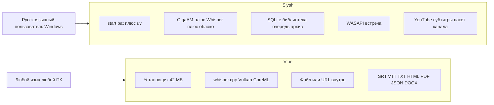

# Конкурентный анализ Slysh vs Vibe

**Дата разбора:** сентябрь 2026  
**Конкурент:** [Vibe](https://thewh1teagle.github.io/vibe/) — [thewh1teagle/vibe](https://github.com/thewh1teagle/vibe) (~7413 звёзд, 521 форк, 154 открытых issue), релиз **v3.2.2** (5 сен 2026).

Документ для возврата к продуктовым решениям. Не заменяет roadmap в issue-трекере; приоритеты ниже можно превратить в тикеты отдельно.

**Источники:** документация и код Slysh, README и issues Vibe, лендинг Vibe.

---

## Кто против кого

**Vibe** — готовый кроссплатформенный десктоп (Tauri + whisper.cpp / sona): Windows / macOS / Linux, подписанный установщик ~42 МБ, автообновления. Windows-setup v3.2.2 скачали ~10 тыс. раз за неделю; `latest.json` автообновлений — ~40 тыс. Позиция: «транскрибируй у себя, приватно, офлайн, почти любой язык».

**Slysh** — Windows-приложение из исходников (`slysh` / `%LOCALAPPDATA%\Slysh`). Ядро — **GigaAM** (SOTA по русскому), плюс Whisper, облачный ASR, диктофон, запись встречи без бота, YouTube по субтитрам (один URL и пакет канала), библиотека jobs в SQLite, редактор сегментов. Дистрибутива exe **нет**.

Прямое сравнение «кто больше фич» проигрышное: Vibe уже продукт с дистрибутивом. Выигрыш возможен как **лучший инструмент для русскоязычной работы с речью**, не как клон Whisper.cpp.

---

## Сильные стороны Vibe

- **Продукт, а не репозиторий.** Один `.exe` / `.dmg` / `.deb` / `.rpm`, автообновления, нотаризация macOS/Windows. Первый запуск измеряется минутами, не часами на torch.
- **Лёгкий офлайн-стек.** ~42 МБ приложение + ggml-модель. GPU через Vulkan (Win/Linux) и CoreML (Mac), не обязателен CUDA/PyTorch.
- **Ширина рынка.** ~100 языков Whisper; Mac + Linux; community Discord; 7k+ звёзд.
- **Полировка UX.** Realtime preview сегментов, follow/unfollow скролла в v3.1.6, длина субтитров под reels, stable timestamps (VAD, ~4× медленнее), печать, кастомные модели через `vibe://download/?url=`.
- **Автоматизация.** CLI, HTTP API + Swagger на `:3022`, agent skills, пакет папок.
- **Постобработка.** Саммари Claude API и локальный Ollama; перевод на английский (Whisper small/medium/large, не turbo).
- **Широкий экспорт.** SRT, VTT, TXT, HTML, PDF, JSON, DOCX.
- **Телефон без магазина приложений.** QR: запись на iOS/Android, расшифровка на ПК.

---

## Слабые стороны Vibe

- **Русский ASR — не его сила.** Движок Whisper / Nemotron / Parakeet. GigaAM-v3 e2e в side-by-side против Whisper-large-v3 выигрывает ~70:30. Для русскоязычного ICP это главный разрыв.
- **GPU на Windows ненадёжен.** [Vulkan OOM](https://github.com/thewh1teagle/vibe/issues/1032), [гибридные ноутбуки берут iGPU](https://github.com/thewh1teagle/vibe/issues/948), [AMD давал `!!!!!`](https://github.com/thewh1teagle/vibe/issues/655), падение sona без Vulkan runtime (внутренняя аналитика: «EOF while parsing»). Облачного ASR как запасного пути нет.
- **YouTube = скачать аудио и прогнать Whisper.** Медленнее и тяжелее, чем взять готовые субтитры. Нет пакета канала с фильтрами, skip completed, Markdown+YAML. Диаризация YouTube уже ломалась ([issue #938](https://github.com/thewh1teagle/vibe/issues/938)).
- **Нет рабочей библиотеки.** Поток ближе к «файл → текст → экспорт», чем к очереди, архиву, повторной расшифровке, правилам пакета.
- **Нет встречи как продукта.** Есть system audio + микрофон, нет выделенного сценария Zoom/Meet/Teams: выбор выхода, микс, пауза, спикеры после стопа.
- **Приватность с оговорками.** «Аудио не уходит» — правда для ASR. Саммари через Claude — облако. Есть клиентская аналитика ошибок.
- **Документация CLI слабая** ([issue #735](https://github.com/thewh1teagle/vibe/issues/735)). Нативные iOS/Android всё ещё «coming soon».
- **154 открытых issue** при активных релизах — типичная цена широкого железа.

---

## Функции Vibe, которых нет у Slysh

Полный список пробелов (не все стоит закрывать):

- Установщик / GitHub Releases / автообновления
- macOS и Linux
- Скачивание аудио с Vimeo / Facebook / Twitter
- Экспорт HTML, PDF, JSON, DOCX (у нас: SRT / VTT / TXT / MD)
- Live-превью сегментов во время файловой расшифровки (у нас прогресс %, текст появляется после завершения job; live/meeting — окна ~10–20 с)
- Саммари: Claude и Ollama
- Перевод на английский
- Печать
- Vulkan / CoreML (не только CUDA torch)
- Кастомные ggml и `vibe://` deep links
- Продвинутые аргументы модели в UI
- Продуктовый CLI и публичный Swagger API для агентов
- VAD stable timestamps
- QR-запись с телефона
- Длина субтитров под shorts/reels
- Модели Nemotron 3.5 и Parakeet TDT v3
- Лендинг, Discord, i18n UI

---

## Что из этого стоит внедрить

Критерий: усиливает русскоязычный Windows-сценарий или снимает барьер «нечем пользоваться», а не копирует Vibe ради паритета.

### P0 — иначе Vibe выигрывает до сравнения качества

- **Установщик Windows** (хотя бы portable / setup.exe + ffmpeg внутри или чек). Без этого сравнение фич бессмысленно: пользователь Vibe уже расшифровывает, пока у Slysh ставится uv/torch.
- **Поток сегментов в редакторе во время job** (как realtime preview Vibe). Библиотека уже есть — не хватает ощущения «текст появляется».

### P1 — высокий ROI, опирается на уже существующий стек

- **Саммари и «разбор» расшифровки** через OpenRouter / Gemini CLI (уже в настройках), опционально Ollama. Не обязательно тащить Claude как бренд.
- **YouTube: fallback на ASR**, если субтитров нет. Сейчас это явный проигрыш Vibe на видео без captions.
- **Экспорт JSON и DOCX** (HTML по желанию). PDF/печать — низкий приоритет.
- **Перевод RU↔EN** LLM-ом провайдера, не Whisper-translate: для русскоязычных EN-only translate Vibe слабее.

### P2 — субтитры и автоматизация

- **VAD / переразметка таймкодов** для SRT (аналог stable timestamps) — важно, если целимся в субтитры, не только в текст встреч.
- **Длина реплики под shorts** — дешёво, если уже есть VAD/reflow.
- **CLI поверх текущего FastAPI** (`slysh transcribe path`) для пакетов без окна.

### Не копировать в ближайший цикл

- macOS/Linux, QR с телефона, печать, Parakeet/Nemotron, Vulkan, `vibe://`. Это чужой рынок и чужой стек. GigaAM+CUDA — наш моат на Windows с NVIDIA.

---

## В чём Slysh сильнее уже сейчас

- **Качество русского.** GigaAM e2e — главная причина выбрать Slysh, а не Vibe.
- **Облако как план Б.** Groq / OpenAI / Gladia (solaria-1 для RU) / Deepgram / OpenRouter / кастомный HTTP / Gemini CLI. Когда GPU больной (типичный кейс Vibe) — Slysh всё равно работает. Можно вообще не ставить torch.
- **Запись встречи.** WASAPI loopback + микрофон, выбор устройства, пауза, job `kind=meeting`, диаризация NeMo после стопа. Это сценарий «созвон → текст», не «файл с диска».
- **YouTube как библиотека, не как скачивалка.** Субтитры через Apify или yt-dlp+cookies, пакет канала/плейлиста, preview `existing_job`, skip completed, автоэкспорт MD с YAML. Vibe качает медиа и гоняет Whisper.
- **Рабочая станция, не одноразовый конвертер.** Очередь, расшифровки, архив, пакеты, фильтры, повтор, отмена, спикеры с именами, плеер с синхроном сегментов, диапазон таймкодов.
- **Архитектура UI без torch.** Окно не тащит PyTorch; engine — отдельный процесс. Для тяжёлого GigaAM это правильнее, чем один процесс Vibe+sona.
- **Русский UI по умолчанию** и сценарии под RU (Gladia solaria-1, Firefox cookies, Apify от PO Token).

---

## Как обойти Vibe и стать лучшим

Не цель: «больше звёзд и все ОС». Цель: **для русскоязычного пользователя на Windows Slysh должен быть очевидным выбором за 15 минут**.

1. **Позиционирование (одно предложение)**  
   «Slysh — локальная расшифровка по-русски лучше Whisper: встречи без бота, YouTube-каналы, GigaAM или облако.»  
   Vibe остаётся «лёгкий Whisper на три ОС». Не спорить с этим.

2. **Снять барьер входа (единственный must, без которого фичи не продают)**  
   Установщик Windows + встроенный/проверяемый ffmpeg + опция «только облако» без 3 ГБ torch. Пока продукт запускается bat-файлом из клона, Vibe выигрывает дистрибутивом.

3. **Удвоить то, где мы уже лучше**  
   Встреча: спикеры «я / они» если возможно развести каналы; меньше латентность live.  
   YouTube: ASR fallback; диаризация после скачивания аудио как опция, не вместо субтитров.  
   Библиотека: довести live-появление текста, чтобы Vibe-превью не ощущалось дырой.

4. **Добавить «после текста»**  
   Саммари, тезисы, перевод — то, за чем пользователь идёт в Ollama/Claude у Vibe. У нас провайдеры уже есть; не хватает кнопки в редакторе.

5. **Не размывать моат**  
   Не переписывать движок на whisper.cpp ради размера. Лёгкий путь — облако и маленький UI; тяжёлый — GigaAM. Два режима, одна библиотека.

6. **Дистрибуция после exe**  
   Короткий лендинг на русском, сравнение «русский / встречи / YouTube-пакет» vs Vibe, GitHub Releases. Переименовать видимые `Slysh` / `slysh`, когда появится установщик — иначе бренд Slysh не существует вне чата разработки.

### Порядок работ (от анализа к разработке)

1. Windows installer / portable (блокирует всё остальное для «обойти»)
2. Streaming сегментов в редакторе
3. Саммари в редакторе через существующих провайдеров
4. YouTube ASR fallback
5. JSON + DOCX экспорт
6. VAD/reflow субтитров
7. Лендинг + Releases + переименование app data — когда 1–4 уже в руках пользователя

---

## Чеклист приоритетов

- [ ] Зафикировать ICP: русскоязычный Windows, не глобальный Whisper-клон
- [ ] P0: Windows installer/portable + ffmpeg check + облако без torch
- [ ] P0: поток сегментов в редактор во время файловой расшифровки
- [ ] P1: саммари LLM, YouTube ASR fallback, экспорт JSON/DOCX, перевод RU↔EN
- [ ] P2: VAD/reflow субтитров, CLI, длина реплики для shorts
- [ ] Не копировать в ближайший цикл: Mac/Linux, QR, Vulkan, Parakeet

---

## Связанные документы Slysh

- [AGENTS.md](../../AGENTS.md) — стадия продукта и навигация
- [YOUTUBE.md](../features/YOUTUBE.md) — YouTube-пакеты и ограничения
- [MEETING-CAPTURE.md](../features/MEETING-CAPTURE.md) — запись встречи
- [REMOTE-ASR.md](../features/REMOTE-ASR.md) — облачный ASR
- [FIRST-RUN.md](../features/FIRST-RUN.md) — барьер входа (uv/torch)
